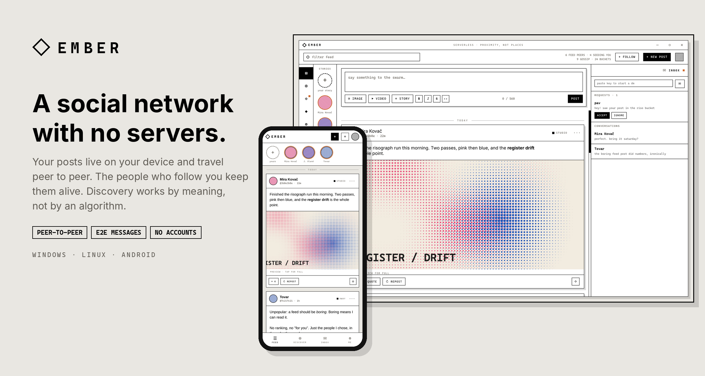
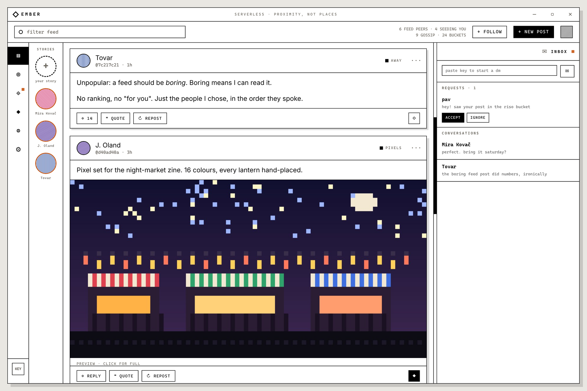
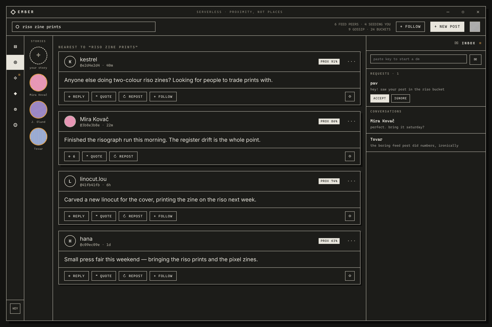
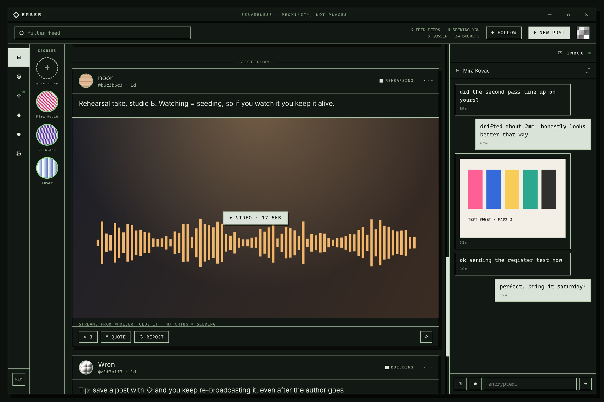
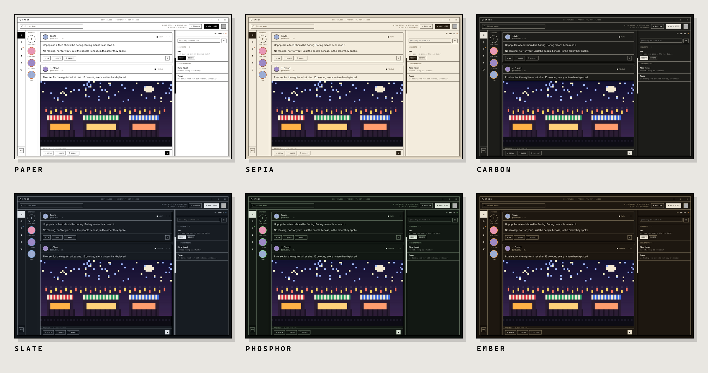

# Ember

**A social network with no servers.** No accounts, no company in the middle, no feed algorithm.

[](https://github.com/CRTnoise/ember-p2p/releases/latest)


### Quick start (about 30 seconds)
1. **Download** from the [latest release](https://github.com/CRTnoise/ember-p2p/releases/latest):
   `Ember-Setup-x.y.z.exe` (Windows installer), `Ember-x.y.z-portable.exe` (Windows, no install), `ember_x.y.z_amd64.deb` (Ubuntu/Debian: `sudo apt install ./ember_x.y.z_amd64.deb`) or `Ember-x.y.z.AppImage` (other Linux, run `chmod +x` on it first).
2. **Run it.** The build isn't code-signed yet, so Windows will say "Windows protected your PC": click **More info → Run anyway**.
3. **Allow Ember on private *and* public networks** when Windows asks, or it can't find anyone.

That's it, you're in the swarm. Want to build it yourself? See [Build from source](#build-from-source).



Your identity is a keypair, your posts are a signed log on your own device, and the people who follow you keep your posts alive by re-sharing them. When nobody keeps something warm, it fades.

Discovery works by *meaning*: posts are hashed into buckets of nearby topics
(locality-sensitive hashing), so writing about something puts you next to
strangers writing about the same thing. Attention follows proximity, not
popularity.

**Topics** put you in rooms with people into the same things from the first
minute, even before you've posted. Discover can also learn what you like, on
your machine only: it shows you *why* each post is there, lets you remove
anything it learned, and has a dial from FAMILIAR to STRANGE. When three people
share a topic room at the same moment, a **campfire** lights: a live chat that
leaves no trace. Moderation is yours: block, mute, or subscribe to the
blocklists of people you trust.

Ember speaks **English, French, Chinese and Arabic** (right-to-left included).

**Use it in a browser, or self-host it.** Turn on SETUP › WEB ACCESS and pair a
browser (or your phone, on the same Wi-Fi) with a code. Or run Ember with no
window on a home server, a Raspberry Pi or a VPS and use it from anywhere:

```bash
cd desktop && npm ci --omit=dev && npm run serve      # prints a key and a pairing code
```

An always-on node also keeps your posts warm while your computer sleeps. See
[desktop/README.md](desktop/README.md#self-hosting) for the options and how to
put it behind HTTPS.

**Nearby** (opt-in, off by default) adds proximity in *space*: see who runs
Ember on the same Wi-Fi, or who opted in near your town. Ember asks your PC
where it is, snaps that to the nearest town, and shares only the town: your
exact position never leaves your computer. One switch (also in the tray) hides
you from Nearby instantly.

Status: **alpha**, built and tested between a handful of people across
France and Algeria. Desktop is the reference client; Android works and
interoperates with it.

| | |
|---|---|
| Feeds | Hypercore append-only logs, replicated by followers (sliding tail window) |
| Networking | Hyperswarm DHT with hole-punching. No Ember servers; joining the DHT contacts public HyperDHT bootstrap nodes |
| Discovery | LSH buckets as swarm topics, named topic rooms (with decoys), a local compass with a FAMILIAR ↔ STRANGE dial, a small-network commons trickle |
| Campfires | live rooms that light when 3+ people share a topic room; signed, memory-only |
| Moderation | personal blocks and mutes, optional shared blocklists, subscriptions, your circle's lists as a quiet signal |
| Languages | English, French, Chinese, Arabic (RTL) |
| Web / self-hosted | the same interface in any browser (paired with a code); `npm run serve` runs a headless node under plain Node |
| Nearby | opt-in: signed beacons on the local network, and grid-cell swarm topics around your town (PC location snapped to a town; only the town is shared) |
| Posts | text with light markdown, images, video (desktop, transcoded with FFmpeg), quotes, replies, reposts, 24h stories |
| Messages | end-to-end encrypted DMs (text, images, voice notes on desktop), offline queue, message requests |
| Trust | Ed25519-signed posts, deletes and DM handshakes |

## A look around


**Your feed.** The people you chose, in the order they posted. No ranking, no "for you".


**Discover by meaning.** A search drops you into the buckets nearest your words; strangers are ranked by how close their posts are to what you asked.


**End-to-end encrypted messages.** Text, images and voice notes, queued while the other person is offline.


**Android.** Same network, same identity format: phones and desktops talk to each other directly.


**Seven themes**, every text colour contrast-checked (MIST not shown).

<sub>Screenshots show the real interface with fictional demo content.</sub>

## Repository
```
desktop/   Electron client (reference implementation)  → desktop/README.md
mobile/    React Native + bare-kit client (Android)     → mobile/README.md
tools/     sync-shared.js: keeps the shared protocol code identical
PROTOCOL.md   what peers say to each other
SECURITY.md   what Ember protects and what it doesn't — read this
```

## Download
Grab the latest build from the **[Releases](../../releases)** page:

| | file |
|---|---|
| Windows (installer) | `Ember-Setup-<version>.exe` |
| Windows (no install) | `Ember-<version>-portable.exe` |
| Ubuntu / Debian | `ember_<version>_amd64.deb` (`sudo apt install ./ember_<version>_amd64.deb`) |
| Linux (any distro) | `Ember-<version>.AppImage` (`chmod +x` it, then run) |

Builds aren't code-signed yet, so Windows SmartScreen will warn
"Windows protected your PC": click **More info → Run anyway**. Each release
lists SHA-256 checksums if you want to verify the file. On first launch,
allow Ember on **private and public** networks or it can't find peers.

## Build from source
Needs [Node.js](https://nodejs.org) 20+.
```bash
git clone <this repo>
cd ember/desktop
npm install
npm start            # run it
npm test             # protocol test suite
npm run build        # Windows → desktop/dist/Ember-Setup-<v>.exe + portable .exe
npm run build-linux  # Linux   → desktop/dist/Ember-<v>.AppImage + ember_<v>_amd64.deb
```
Build Windows binaries on Windows and Linux binaries on Linux. Android needs
its own toolchain: follow [mobile/README.md](mobile/README.md).

## Before you rely on it
Ember is peer-to-peer, so **peers can see your IP address**, and public posts
are public by design. DMs are end-to-end encrypted but their metadata isn't
hidden. Back up your identity: there is no account recovery. Details in
[SECURITY.md](SECURITY.md).

## Contributing
Changes to `desktop/src/protocol.js`, `discovery.js` or `dm.js` must be
mirrored to mobile with `node tools/sync-shared.js` (CI can run it with
`--check`). Run `npm test` in `desktop/` before opening a PR.

## License
Copyright (C) 2026 CRTnoise. Ember is free software under the
[GNU GPL v3](LICENSE) or any later version: you can use, study, modify and
share it, and anything you distribute that's built from it must stay open
under the same terms. Desktop builds bundle FFmpeg (also GPL); see
[NOTICE.md](NOTICE.md).
