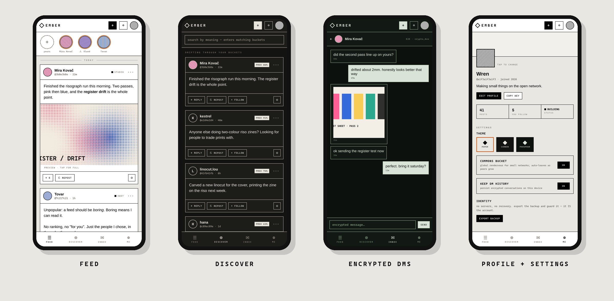

# Ember Mobile (Android)



React Native UI on top of a **bare-kit worklet running the same P2P engine as
the desktop app**. A phone is just another Ember peer: same identity format,
same feeds, same gossip, same encrypted DMs. Desktop and mobile interoperate.

```
┌─ React Native (UI only) ─────────────────┐
│  App.tsx · src/screens · src/components  │
│        │  JSON-RPC over the worklet IPC  │
├─ bare-kit worklet (Bare runtime) ────────┤
│  worklet/backend.mjs   the engine        │
│  worklet/protocol.mjs  shared protocol   │
│  corestore · hyperswarm · sodium         │
└──────────────────────────────────────────┘
```

Status: **alpha.** Text posts, images, stories, replies, saves, discovery,
encrypted DMs, notifications and settings work device↔desktop. Video posting
and voice notes are desktop-only for now (mobile shows them as placeholders).

## Requirements
- Node 18+, **JDK 17** (not 21+, not 26: Gradle can't read newer class files)
- Android SDK with **NDK 26.1.10909125** (SDK Manager → SDK Tools → Show Package Details)
- An Android device or emulator, API 29+

## Build

```bash
# 1. a fresh RN project at the version this was built against
npx @react-native-community/cli init EmberMobile --version 0.74.5
cd EmberMobile

# 2. copy this folder's contents over it (App.tsx, index.js, src/, worklet/,
#    patches/, scripts/), then install
npm install react-native-bare-kit@0.15.0 buffer b4a corestore hyperswarm hypercore \
            sodium-universal bare-fs bare-path bare-crypto react-native-image-picker
npm install --save-dev bare-pack patch-package

# 3. apply every Android fix (New Architecture, minSdk 29, Gradle 8.5,
#    permissions, metro .mjs, patch-package hook). Idempotent.
node scripts/configure-android.js
npm install            # runs patch-package via postinstall

# 4. bundle the engine for the Bare runtime, then run
npm run bundle:engine
npx react-native run-android
```

**Re-run `npm run bundle:engine` after every change under `worklet/`.**
The app runs a bundled snapshot of the engine; UI changes hot-reload, engine
changes don't.

Optional: `npm install @react-native-clipboard/clipboard` for real
copy-to-clipboard (needs a native rebuild). Without it, COPY KEY falls back to
the share sheet.

If `applicationId` isn't `com.embermobile`, update the path in `src/fsdir.ts`
(the configure script warns you).

## When the build fights you
See [TROUBLESHOOTING.md](TROUBLESHOOTING.md) — every error we actually hit,
with its real cause.
